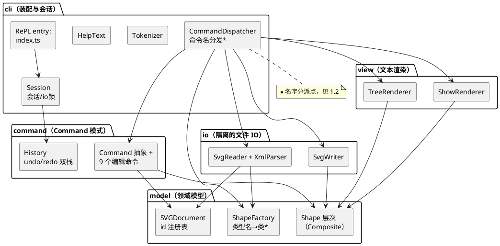

# Lab1 Phase 1：SVG 编辑器（CLI）——架构文档

- 语言/范式：TypeScript + 面向对象（类层次 + 多态、字段封装、一类一文件）
- 运行：`npm install && npm run cli`（零运行时依赖）；测试：`npm test`；依赖检查：`npm run check:deps`

---

## 1 架构方案

### 1.1 模块划分

| 模块（目录） | 职责 | 关键类 |
|---|---|---|
| `model/` | 领域模型：图形层次、文档与 id 注册表、类型工厂。**不依赖任何其他模块** | `Shape`（抽象基类）、`RectShape` / `CircleShape` / `EllipseShape` / `LineShape` / `TextShape` / `GroupShape`、`SVGDocument`、`ShapeFactory` |
| `command/` | Command 模式：每条可撤销编辑命令一个类 + 撤销/重做双栈 | `Command`（抽象）、`CreateCommand` / `DeleteCommand` / `MoveCommand` / `ScaleCommand` / `SetCommand` / `GroupCommand` / `UngroupCommand` / `AddToCommand` / `ZOrderCommand`、`History` |
| `io/` | SVG 文件的解析与序列化（IO 隔离；XML 解析器手写、零依赖） | `XmlParser` / `XmlNode`、`SvgReader`、`SvgWriter` |
| `view/` | 显示类命令的文本渲染（tree / show） | `TreeRenderer`、`ShowRenderer` |
| `cli/` | 会话状态机、行词法、命令名分发、REPL 装配 | `Session`、`CommandDispatcher`、`Tokenizer` / `Token`、`HelpText` |
| `src/` 根 | 共享内核（全局错误类型）与入口 | `CliError`、`index.ts` |

`index.ts` 只做装配；`src/test/` 是 golden 回放测试（允许依赖一切）。

**PlantUML 组件图**：



### 1.2 设计模式的选择

**(1) Command 模式（本阶段必须）——撤销/重做的骨架**

- 为什么：规格要求“一条编辑命令 = 一个 undo 单元”且 undo 后新编辑要清空 redo 栈。把每条编辑做成对象（携带执行所需的全部参数与“逆操作所需的状态快照”），双栈 `History` 只面向 `Command` 抽象，天然满足这两个语义。
- 落地：
  - `command/Command.ts`：抽象类，`execute(): string` / `undo(): string`（返回回显消息），`execute` 内**先完成全部校验再变更状态**——失败抛 `CliError`，不留下半成品（规格：“命令失败不改变任何状态”）；
  - 九个编辑动词各一类（`front`/`back` 共用 `ZOrderCommand`，构造参数区分方向）；
  - **redo 复用 `execute()`**：命令对象自持上下文（如 `DeleteCommand` 在 execute 时保存被删图形的对象引用、原父级、原下标，undo 放回，execute 重删）；
  - 消息由命令对象产生（`rect#box restored into g#markers` 这类回显写在命令里），显示层不需要理解命令语义。
- io 边界：文档类命令（init/read/save/canvas 改尺寸）**不进 Command 体系**——它们语义上不可撤销。`Session` 在其成功后清空双栈并上 `ioLocked` 锁，`undo`/`redo` 报 `error: undo not allowed after io command`，直到下一条**成功**编辑命令解禁（失败的编辑不解禁，因为失败不改变状态）。

**(2) Composite 模式——容器与叶子的统一操作**

- 为什么：规格要求 `move/scale/set/delete` 对 `<g>` 与叶子一视同仁，`group` 的目标可以同时含容器与普通图形，还预告了 `box`（g + rect + text 的复合）插件。
- 落地：`Shape` 抽象基类声明 `moveBy/scaleBy/scaleBackBy/setGeometry/...`；`GroupShape` 递归转发给全部子孙；九个命令**只面向 `Shape` 抽象**，完全不含 `instanceof` 或按 `kind` 的 switch——新增容器型图形（如未来的 `box`）无需改动任何命令。
- 一个刻意的设计决策：容器的 `move` **不用 transform**，而是递归改写子孙的几何属性。理由：与 `scale` 的“factor 同乘全部几何属性”语义对称、`tree`/`show` 能内联显示真实坐标、save/read 往返后数据一致。代价是序列化结果中不出现 `transform`（详见 §2 过程记录第 1 条）。

**(3) Factory 模式（简单工厂）——类型名 → 类的唯一映射**

- `ShapeFactory` 同时服务两个入口：CLI 语法 `create`（严格校验、报 usage/invalid number）与 `SvgReader` 的 XML 属性映射（宽松缺省）。**按名字分派在全工程只出现两处**（规格允许的上限）：
  1. `cli/CommandDispatcher`：命令名 → 处理器；
  2. `model/ShapeFactory`：图形类型名 → 类。
  两处源码中均以注释标注【待重构】。

### 1.3 依赖方向规则

| 允许的依赖 | 理由 |
|---|---|
| 任何人 → `model`（及 `src/` 根共享内核 `CliError`） | 领域模型是稳定核心；错误类型是全层共用的最小契约 |
| `command` → `model` | 命令是对领域对象的操作，不应知道 IO 与界面 |
| `io` → `model` | 解析产出领域对象、序列化消费领域对象；反过来则 model 被文件格式绑架 |
| `view` → `model` | 渲染领域对象；不操作、不修改 |
| `cli` → `command` / `io` / `view` / `model` | cli 是装配层与文本协议（词法/分发）层，位于系统顶端 |
| `test` → 一切 | 测试从外部观察整个系统 |

禁止（并说明为何天然不会发生）：

- `model` → 任何模块：model 无 import 指向 io/cli/view/command，保证领域层可被未来 GUI/agent 通道直接复用；
- `command` → `io` / `view` / `cli`：命令可撤销性只依赖领域状态；
- `io` ↔ `view`、`command` ↔ `view`：互不相干，出现即越界；
- 任何模块 → `cli`：cli 是顶端，被依赖意味着核心逻辑漏进装配层。

自动化执行：`npm run check:deps`（`scripts/check-deps.mjs`）扫描全部相对 import 并对照上述矩阵，违规即失败——输出见 §3。

### 1.4 变化点假设

| # | 假设会变的地方 | 为它留了什么 / 为什么不留 |
|---|---|---|
| 1 | **新图形类型，尤其是插件化阶段的 `box`**（规格已明示） | 预留：`ShapeFactory` 是类型唯一映射点，改成 `ShapeProvider` 注册表只动这一个类；Composite 已保证“g+rect+text 组成的子树”可被全部命令统一操作（`box` 正是这种子树）。序列化侧图形**自序列化**（`writeSvg` 多态），`box` 加 `data-kind` 标记只需改 `GroupShape`/插件自身。**没有**为 `box` 提前写任何代码——阶段边界明确，提前实现只会把未定的插件接口焊死 |
| 2 | **新命令** | `Command` 抽象 + `CommandDispatcher` 注册表：新命令 = 一个新类 + 一行注册，`History` 零改动 |
| 3 | **输入通道从 CLI 扩展到 GUI / agent** | `Session.executeLine(line): string[]` 是纯“文本进、文本出”的接口，不触碰 readline/stdout；`index.ts` 的 REPL 只是一层 6 行的壳。GUI 通道换掉壳即可，命令、模型、undo 全部复用 |
| 4 | **序列化格式 / round-trip 要求增强**（如保留未知属性、`data-kind` 还原） | IO 隔离在 `io/` 两端（`SvgReader`/`SvgWriter`），模型不知道文件长什么样；改格式不动 model |
| 5 | **undo 策略变化**（宏命令、持久化历史、上限） | `History` 只面向 `Command` 抽象；宏命令可以做成“命令组合命令”而不改调用方 |
| 6 | **不变的：id 寻址约定、坐标系** | 不留缝。id 定位是规格定的公共约定（三种通道共用），坐标系跟随 SVG 规范；为确定的东西留抽象缝是过度设计 |

---

## 2 过程记录（与 AI 协作的关键迭代）

以下记录的是“AI 给出的建议/代码 → 我发现问题 → 确认并纠正”的真实往返，按时间顺序。

**1. 容器 move：transform 方案被否。** AI 初版建议容器移动用 `transform="translate(dx,dy)"` 实现（“更 SVG 原生、O(1)”）。检查规格后发现矛盾：`scale` 明确定义为“factor 同乘到图形的全部几何属性，递归到每个子孙”，若 move 走 transform、scale 走改写坐标，两种操作在语义上不对称；且 `tree`/`show` 要求内联显示几何属性，transform 会让显示值与真实渲染位置脱节。改为 move/scale 一律递归改写子孙几何属性，并在 `GroupShape` 的注释里记录了这个取舍。

**2. undo 与 io 边界的语义澄清。** AI 初版只加了一个“禁用标志”但保留了历史栈，讨论中构造出反例：`create r1; save f.svg; move r1 10 0; undo; undo` 第二次 undo 会**跨过 save 边界**撤销到 save 之前，内存态与已落盘文件的关系变得不可解释。最终语义：io 命令成功即清空双栈并上锁（报规格指定的错误消息），下一条成功编辑命令重新解禁。该语义被 golden 测试 `io-lock-canvas-resize` 与 §6 回放中的 `save → undo → error` 固化。

**3. `GroupCommand` 原子性缺陷（冒烟测试抓到的真 bug）。** AI 初版只摘除了**第一个**成员就创建新组并往里挂其余成员——第二个成员仍在 id 注册表中，`attach` 抛 `id already exists`，且现场留下“新组已创建、只装了一半”的半成品状态，直接违反“命令失败不改变任何状态”。修复为：全部校验前置，然后**先摘除所有成员**再建组挂载，使校验后的路径不可能失败。这个 bug 成了 §4 测试集中 group 相关用例的动机。

**4. scale 撤销的浮点漂移。** AI 初版 undo 用 `scaleBy(1/factor)`：`100*3` 再 `*0.333…` 得 `99.99999999999999`，tree 输出会带着噪声。改为对称的除法逆运算 `scaleBackBy(factor)`（`x/f`），当正向乘法精确时除法严格还原。`scale-exact-roundtrip` 用例专门断言 `×3 → undo → show` 后坐标逐字符等于原值。

**5. XML 解析选型：拒绝引库。** AI 建议引入 `fast-xml-parser`/`sax`。考虑到本工程的卖点是零运行时依赖与可控错误消息（规格的错误表要求 `cannot read file` / 解析失败要转成 `error:` 行），改为手写约 150 行递归下降解析器（覆盖声明/注释/DOCTYPE/CDATA/实体），解析错误统一转 `CliError`。`err-invalid-xml`、`err-not-an-svg-document` 用例验证错误路径。

**6. 规格未定义之处的自主决策（并全部记入本节）。** 与 AI 对表 §4.2 时发现若干场景规格没有给出文案/语义，逐一拍板并保持风格一致：`addto g1 g1`（把容器放进自己/自己的子孙）→ `error: cannot add a container into its own descendant: <id>`（与 group 的同类错误对齐）；`save` 无参数且从未 read → `error: no file specified`；undo/redo 空栈 → `nothing to undo/redo`；`canvas W H` 修改成功回显 `canvas WxH updated`。另发现规格 §6 两处 tree 示例的列对齐宽窄不一致（手排版痕迹），统一定义为“同一棵（子）树内标签按最长者对齐 + 2 空格”并写入 `TreeRenderer` 注释——这是一次有记录的规格澄清，见 §3 修订记录。

**7. 测试期望的两处自我纠正。** 首轮测试 36/40：其中两处失败是**测试写错而非实现错**——(a) 全部撤销后 `redo` 应重做最后一条被撤销的命令（`create`），测试却期望报错；(b) 一个用例把 `box` 建在根级然后 `ungroup`，而规格明确根级容器不可解散（已有专门错误用例）。修正测试而非迁就实现，是 golden 测试该有的方向。

---

## 3 一致性自查

### 3.1 模块划分：方案 vs 实际目录

| 方案（§1.1） | 实际（`tree src`） | 一致？ |
|---|---|---|
| model/：Shape 层次 + SVGDocument + ShapeFactory | `src/model/`（12 文件） | ✅ |
| command/：Command 抽象 + 9 命令 + History | `src/command/`（11 文件） | ✅ |
| io/：XmlParser/SvgReader/SvgWriter | `src/io/`（4 文件） | ✅ |
| view/：TreeRenderer/ShowRenderer | `src/view/`（2 文件） | ✅ |
| cli/：Session/CommandDispatcher/Tokenizer/HelpText | `src/cli/`（6 文件） | ✅ |
| src 根：CliError + index.ts | `src/CliError.ts`、`src/index.ts` | ✅ |

结论：实际目录与方案完全一致，无不一致项需要记入修订。

### 3.2 依赖方向：自动化检查

`npm run check:deps`（对照 §1.3 矩阵扫描全部相对 import）输出：

```text
依赖边统计（from -> to: 条数）：
  (root) -> cli: 1        # index.ts 装配 REPL
  cli -> (root): 3        # CliError 共享内核
  cli -> command: 11
  cli -> io: 2
  cli -> model: 4
  cli -> view: 2
  command -> (root): 7
  command -> model: 22    # 命令只依赖领域模型
  io -> (root): 3
  io -> model: 6          # 解析/序列化只依赖领域模型
  model -> (root): 10     # model 不依赖任何业务模块
  test -> cli: 1
  view -> model: 4

OK: 依赖方向全部符合架构方案
```

零违规；特别地，`model` 没有任何指向 io/cli/view/command 的边，`command` 没有任何指向 io/view/cli 的边。抽样手工核对（`grep -r "from '\.\./" src/model` 无业务模块）与脚本结论一致。

### 3.3 修订记录

| 日期 | 项 | 内容 |
|---|---|---|
| 2026-10-16 | 规格澄清 | 规格 §6 两处 tree 示例对齐不一致 → 统一为“最长标签 + 2 空格”规则（`view/TreeRenderer.ts` 注释） |
| 2026-10-16 | 规格补充 | `addto` 自包含/含子孙、`save` 无路径、空栈 undo/redo 等未定义场景的消息定义（§2 第 6 条） |
| 2026-10-16 | 实现修正 | `GroupCommand` 原子性（§2 第 3 条）；分发器方法改箭头绑定修复 `this` 丢失 |

---

## 4 质量保证手段

1. **规格会话逐行回放（golden test）**：`npm test` 共 **40 个用例**，全部通过。其中最重要的是把规格 §6、§6.1 两个完整会话**原文**作为脚本回放，输出与规格逐行比对（含中文文本、警告顺序、错误消息），并断言 `flowchart.svg` 保存产物的完整内容。
2. **错误表全覆盖**：§4.2 的每一种错误（id 冲突、容器校验、未知类型、根级 ungroup、非法缩放、文件不存在/不可写、无文档、文件内重复 id、非法 XML、非 SVG 文档……）各有一个用例；`box` 在本阶段报 `unknown shape type` 也有专门用例锁定阶段边界。
3. **语义边界的对抗性用例**：redo 栈清空时机、io 锁的解禁条件（失败的编辑不解禁）、z-order 往返、group/ungroup/addto 后位置的**精确**恢复、`scale ×3 → undo` 的浮点零漂移、`save → read → save` 字节级一致（覆盖 `& < >` 的 XML 转义往返）、viewBox 兜底、自动补 id 递增、注释/空行/引号词法。
4. **编译期保证**：`tsc --strict`（`noImplicitOverride` 等）零错误零警告；git 每个阶段提交都要求先通过编译。
5. **架构保证**：`npm run check:deps` 机器检查依赖方向（§3.2），防止“文档说一套、代码另一套”。
6. **人工验收**：把 `save` 产出的 `flowchart.svg` 经本地 HTTP 服务在真实浏览器中打开并截图目测：蓝色“开始”节点、橙色“处理数据 v2”节点（中文标签正常渲染）、连线均在预期位置；REPL 交互式敲入 §6 脚本核对输出。已知局限（有意为之，见变化点）：读入时模型未覆盖的属性（如 `font-size`、非 transform 的未知属性）会被丢弃；`scale` 不作用于 `font-size`（不在 set 白名单）。

提交历史（`git log --oneline`）按“骨架 → model → command → io → cli/view → test → doc”分步推进，每步可独立编译，无 one-shot 大提交。
